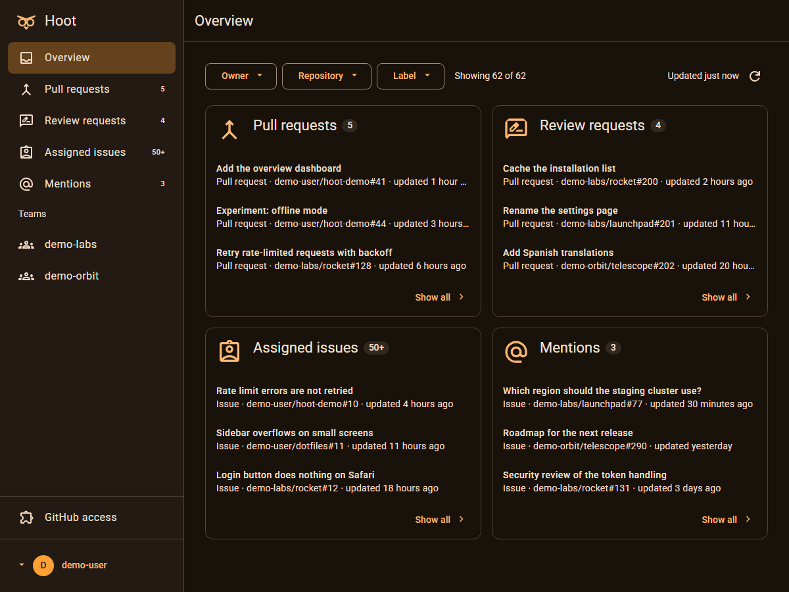

# Hoot

Everything waiting on you on GitHub, on one page: your open pull requests, review requests, assigned issues and mentions, across all your repositories and organizations. Plus a team view per organization that shows what needs the team's attention.



*The overview in dark mode, with made-up data from the demo mode.*

## Features

- **Overview:** one card per list with its count and newest items, and the counts in the sidebar
- **List pages:** every item with load more, sorting, grouping by repository, and the details of each item (reviewers, CI checks, milestone)
- **Filters** by owner, repository and label, saved per user and shared by every page
- **Team view** per organization: waiting for review, failing CI, unassigned, stale. Work items and team totals only, no numbers per person.
- Sign-in with GitHub, read-only; light and dark mode

Built with FastAPI, SQLite, Angular 22 and Angular Material.

## Quick start

You need Python 3.12, Node.js 24 LTS and a GitHub account.

```
python -m venv venv
venv\Scripts\activate                     # macOS / Linux: source venv/bin/activate
pip install -r backend/requirements-dev.txt
python backend/setup_github_app.py        # once: creates your GitHub App and .env
python backend/app/main.py                # backend on http://localhost:8000
```

In a second terminal:

```
cd frontend
npm install
npm start                                 # frontend on http://localhost:4200
```

Open `http://localhost:4200`, sign in with GitHub, and install the app on your account when Hoot asks.

To look at the UI without any of that: `cd frontend`, `npm install`, `npm run demo`.

The full setup, the manual GitHub App steps and troubleshooting are in [docs/development.md](docs/development.md).

## Documentation

| | |
| --- | --- |
| [Development](docs/development.md) | Setup, running, demo mode, tests, troubleshooting |
| [Configuration](docs/configuration.md) | Every `.env` setting ([`.env.example`](.env.example)) |
| [Architecture](docs/architecture.md) | Sign-in, session, calls to GitHub, database |
| [API](docs/api.md) | Routes and response shapes |
| [Security](docs/security.md) | Tokens, cookies, privacy |
| [Backend](docs/backend.md) | Modules, adding a route, tests |
| [Frontend](frontend/README.md) | Architecture, design system, components, pages |
| [Specs](docs/specs/README.md) | The rules and decisions Hoot is built on |
| [Contributing](CONTRIBUTING.md) | Issues, branches, commits, pull requests |

## Status

Early. Sign-in, the overview, the list pages, filters and the team view work; the open issues hold what's next.
