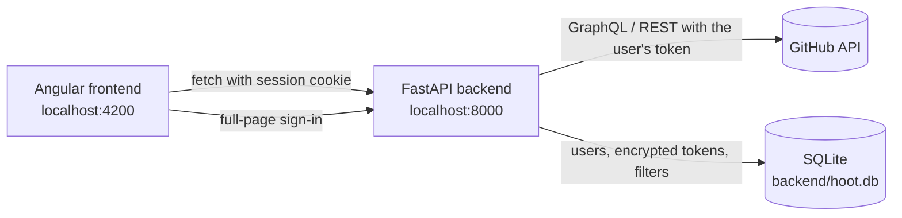
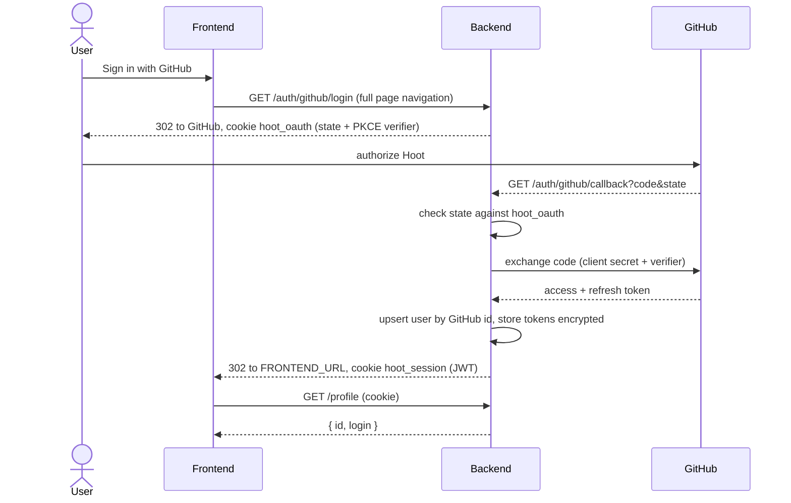
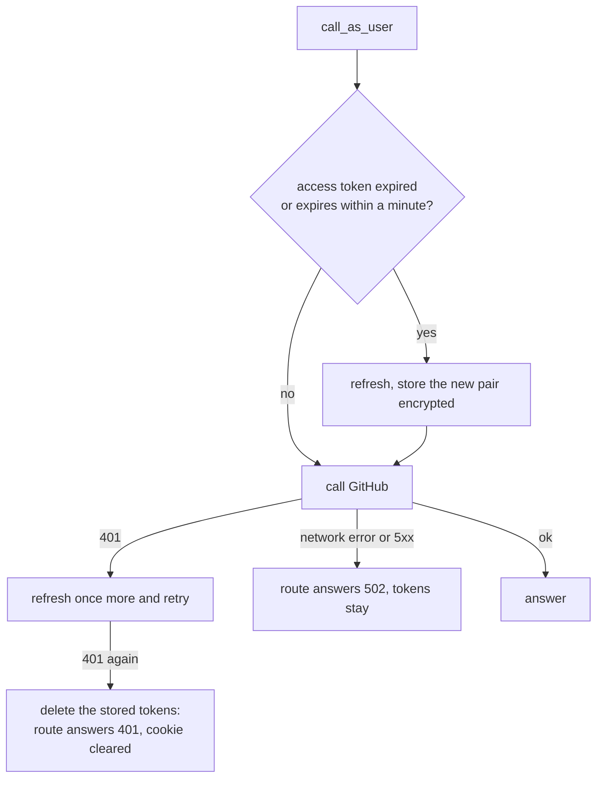

# Architecture

How Hoot's parts fit together. Details per half: [backend.md](backend.md) and [frontend/architecture.md](frontend/architecture.md).

## Overview



- **Frontend** (`frontend/`): an Angular 22 single-page app with Angular Material. It never sees a token: the session lives in an HttpOnly cookie.
- **Backend** (`backend/app/`): a small FastAPI app. It signs users in with GitHub, keeps the session, stores the users' GitHub tokens encrypted, and asks GitHub on each user's behalf.
- **Database**: one SQLite file for users, their encrypted GitHub tokens and their overview filters. Created on first start.
- **GitHub**: Hoot keeps no copy of GitHub data. Every page load asks GitHub with the signed-in user's own token, so a user only ever sees what they could see on GitHub.

## Sign-in

Users sign in with their GitHub account through a GitHub App (OAuth with `state` and PKCE). Hoot then keeps its own session as a JWT in the HttpOnly cookie `hoot_session`. The security rules behind each step are in [specs/sign-in-security.md](specs/sign-in-security.md).



If the user cancels on GitHub or the exchange fails, the callback redirects to `FRONTEND_URL/login?error=github` without a session. Logout (`POST /logout`) deletes the cookie.

## Session

- The JWT holds `sub` (the user id as a string), `auth_time` (the time of the sign-in) and `exp`.
- `get_current_user` reads only the cookie (an `Authorization` header is not accepted), decodes it, rejects sessions older than `SESSION_MAX_DAYS` since `auth_time`, and loads the user.
- **Sliding session:** when less than half of `ACCESS_TOKEN_EXPIRE_MINUTES` is left, the response sets a fresh cookie with the same `auth_time`. An active user stays signed in; a session still ends `SESSION_MAX_DAYS` after signing in.
- In the frontend, `services/session-interceptor.ts` sends every backend request with credentials, and a `401` during an active session clears it and opens `/login`.

Example payload:

```json
{ "sub": "1", "auth_time": 1709996400, "exp": 1710000000 }
```

## Calls to GitHub on the user's behalf

GitHub App user tokens expire after 8 hours; the refresh token lasts 6 months. Every call to GitHub for a user goes through `github_tokens.call_as_user`:



- No refresh token, an expired one, or GitHub rejecting it (e.g. the user revoked Hoot) ends the same way: tokens deleted, `401`, the frontend sends the user to sign in.
- Refresh tokens work only once, so parallel requests of one user refresh one at a time (a lock per user). A request that waited uses the token the other just stored instead of refreshing again. The lock covers one backend process, which is how Hoot runs.
- A GitHub App user token only reaches accounts where the app is installed, so an empty result can mean "not installed". `/github/installations` tells the frontend where it is installed.

## Data flow of a page

1. The frontend loads the overview once (`GET /overview`, four GitHub searches in one GraphQL query) and shares it between the dashboard and the sidebar counts.
2. The user's filters come from `GET /overview/filters` and are applied in the browser; `/overview` always returns everything.
3. The list pages load one list page by page (`GET /lists/{name}`, 50 items per page).
4. The team view loads one organization (`GET /orgs/{organization}/overview`).

The routes and response shapes are in [api.md](api.md).

## Database

There are no migrations: tables are created with `Base.metadata.create_all` on import. A new table needs nothing; a changed column needs a fresh database (delete `backend/hoot.db`, users sign in again) or a manual `ALTER`.

`users`: a user is identified by the GitHub account's numeric id, because a login can be renamed and then taken by someone else.

| Column | Description |
| --- | --- |
| `id` | Primary key (the `sub` of the session JWT) |
| `github_id` | Unique numeric GitHub user id |
| `login` | GitHub login, updated on every sign-in |
| `github_access_token` | Encrypted user access token; empty after GitHub rejected it |
| `github_access_token_expires_at` | Unix timestamp, or empty if it doesn't expire |
| `github_refresh_token` | Encrypted refresh token, if GitHub issued one |
| `github_refresh_token_expires_at` | Unix timestamp |

The overview filters, one row per entry:

| Table | Columns | Holds |
| --- | --- | --- |
| `hidden_scopes` | `id`, `user_id`, `scope` | Hidden owners (`octo-org`) and repositories (`octo-org/hoot`), lowercase |
| `shown_labels` | `id`, `user_id`, `label` | Labels picked in the label filter, lowercase |

## Repository layout

```
Hoot
├── .env.example            every backend setting, copy to .env
├── backend
│   ├── setup_github_app.py one-time local setup: creates the GitHub App, fills .env
│   ├── app                 the FastAPI app (modules: backend.md)
│   └── tests               pytest, with a fake GitHub
├── frontend
│   ├── public              favicons
│   └── src
│       ├── app             the Angular app (folders: frontend/architecture.md)
│       ├── styles.css      Hoot's design tokens
│       └── material-theme.scss, _theme-colors.scss
├── docs                    this documentation
└── .github/workflows       tests, Claude review
```
