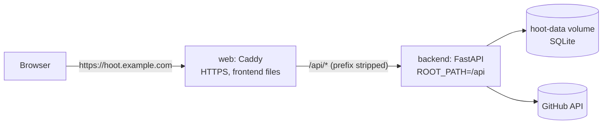

# Deployment

Running Hoot on a server for other people. It runs on any machine with Docker and a domain; picking a provider is up to you.

## How it runs



Two containers from `docker-compose.yml`:

| Service | Image | Does |
| --- | --- | --- |
| `web` | `frontend/Dockerfile`: builds the frontend with Node, serves it with Caddy | HTTPS (certificates from Let's Encrypt, renewed by itself), the frontend at `/`, everything under `/api/` passed to the backend with the prefix stripped (`deploy/Caddyfile`) |
| `backend` | `backend/Dockerfile`: Python with the backend | The API, run with `ROOT_PATH=/api` so its cookie paths and `/api/docs` include the prefix; the database on the `hoot-data` volume |

Frontend and backend share one origin, so the session cookie works without extra setup and the browser makes no cross-origin requests. The production build of the frontend calls `/api` (`frontend/src/app/api.production.ts`).

The backend runs as **one process**: refreshing a user's GitHub token is serialised within a process, and SQLite suits one writer. That is plenty for a team.

## Requirements

- A Linux server with Docker Engine and the Compose plugin, ports 80 and 443 open
- A domain (or subdomain) whose DNS `A`/`AAAA` record points at the server, e.g. `hoot.example.com`
- A GitHub App for this domain (next section)

## GitHub App for production

Create a separate app for the server; the local one points at `localhost`. Follow the manual steps in [development.md](development.md#manual-setup) with these values (`hoot.example.com` stands for your domain):

| Setting | Value |
| --- | --- |
| Homepage URL | `https://hoot.example.com` |
| Callback URL | `https://hoot.example.com/api/auth/github/callback` |
| Setup URL (post installation) | `https://hoot.example.com/`, with *Redirect on update* on |
| Request user authorization (OAuth) during installation | off |
| Webhook | off |
| Repository permissions | Issues, Pull requests, Checks, Commit statuses: read-only |
| Where can this GitHub App be installed? | *Any account*, so organizations can install it |

Then create a client secret on the app's page (**Generate a new client secret**) and keep it for `.env`.

## Configuration

On the server, next to `docker-compose.yml`, create `.env` from [`.env.example`](../.env.example). Every variable is described in [configuration.md](configuration.md); for production:

```
DOMAIN=hoot.example.com

SECRET_KEY=<random, at least 32 bytes>
TOKEN_ENCRYPTION_KEY=<Fernet key>
GITHUB_CLIENT_ID=<from the production app>
GITHUB_CLIENT_SECRET=<from the production app>
GITHUB_APP_SLUG=<the production app's URL name>

GITHUB_CALLBACK_URL=https://hoot.example.com/api/auth/github/callback
FRONTEND_URL=https://hoot.example.com
CORS_ORIGINS=https://hoot.example.com
COOKIE_SECURE=true
```

Use new keys for the server, not the ones from your machine. `ROOT_PATH` and `DATABASE_URL` are set by `docker-compose.yml`. Keep `.env` readable only by you (`chmod 600 .env`); it is never copied into an image (`.dockerignore`).

## Start

```
git clone https://github.com/kgeestmann/Hoot.git
cd Hoot
# create .env as above
docker compose up -d --build
```

The first start takes a few minutes (building the images) and Caddy then fetches the certificate. Open `https://hoot.example.com`, sign in, and install the GitHub App on your account.

Check it:

```
docker compose ps                       # both services running
docker compose logs -f backend          # backend log
curl https://hoot.example.com/api/      # {"message":"Hoot backend is running."}
```

## Update

```
git pull
docker compose up -d --build
```

Sessions survive an update (they are signed cookies), and so does the database (the `hoot-data` volume).

## Backup

The `hoot-data` volume holds the SQLite database: users, their encrypted GitHub tokens and their filters. No GitHub data is stored, so losing it only means everyone signs in and sets their filters again. To back it up:

```
docker compose exec backend python -c "import sqlite3; sqlite3.connect('/data/hoot.db').backup(sqlite3.connect('/data/backup.db'))"
docker compose cp backend:/data/backup.db ./hoot-backup.db
```

The backup is only useful together with the same `TOKEN_ENCRYPTION_KEY`; without it the stored tokens can't be read and users sign in again.

## Trying it locally

`DOMAIN=localhost` works for a test on your machine: Caddy then uses its own local certificate, which the browser warns about. Signing in needs a GitHub App whose callback URL is `https://localhost/api/auth/github/callback`.
